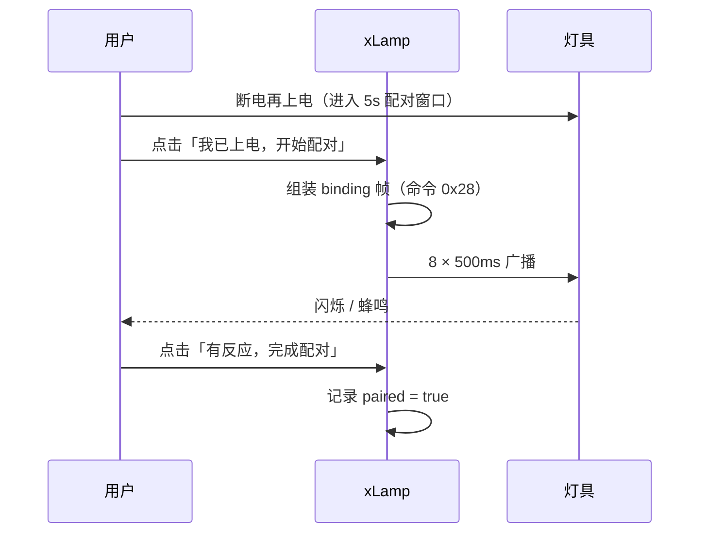

<div align="center">


# xLamp

**一个用 Flutter 复刻 LampSmartPro 核心链路、通过 BLE 广播直接控制灯具的 Android 应用**

只保留「配对」和「控制」，不建立 GATT 连接、不需要账号、不采集任何数据。

[](https://github.com/qinjunhaocn/xLamp/actions/workflows/android.yml)
[](https://github.com/qinjunhaocn/xLamp/releases)
[](#-下载与安装)
[](https://flutter.dev)
[](https://dart.dev)
[](#-界面)
[](#-工作原理)
[](LICENSE)

</div>

---

## 📖 目录

- [项目简介](#-项目简介)
- [功能特性](#-功能特性)
- [界面](#-界面)
- [工作原理](#-工作原理)
  - [整体链路](#整体链路)
  - [31 字节 v3 帧](#31-字节-v3-帧)
  - [亮度与色温](#亮度与色温)
  - [广播时序](#广播时序)
  - [配对流程](#配对流程)
- [技术栈](#-技术栈)
- [下载与安装](#-下载与安装)
- [本地构建](#-本地构建)
- [CI 与签名](#-ci-与签名)
- [目录结构](#-目录结构)
- [常见问题](#-常见问题)
- [免责声明](#-免责声明)

---

## 🧭 项目简介

市面上的灯具 App 往往体积大、广告多，而实际控制链路其实很简单。**xLamp** 通过对
`LampSmartPro 1.4.0` 的静态逆向，把真正有用的部分独立重写出来：

- **不连接灯具**：原 App 从未使用 GATT 写特征值，而是把指令编码成 **BLE 广播中的
  Service UUID**，由灯具固件在扫描时接收。
- **只做两件事**：把手机和灯「配对」、之后「控制」它。
- **完全离线**：没有网络请求、没有统计 SDK、没有账号体系。

因此 xLamp 的体积、启动速度和隐私表现都远好于原 App，同时保留相同的控制效果。

## ✨ 功能特性

| 能力 | 说明 |
|---|---|
| 🔗 一键配对 | 断电→上电→5 秒内点按，灯闪烁/蜂鸣即成功 |
| 🔌 开关控制 | 大号电源键，单击切换 |
| 🔆 亮度调节 | 1–100%，映射到设备 0–255 双通道，最亮可达满功率 |
| 🌡 色温调节 | 暖光 ↔ 冷光连续调节，冷暖通道自动分配 |
| 🎨 颜色控制 | 12 色预设 + HSV 自定义取色 |
| 🎬 场景 | 场景 1–4、场景开、夜灯 |
| 🧩 多设备 | 灯具 / 风扇 / 换气 / 浴霸，独立地址与通道 |
| 🎛 广播参数 | 时长、重复窗口、间隔均可调 |
| 🌈 Monet 取色 | Android 12+ 跟随壁纸配色，支持浅色/深色/跟随系统 |
| 🧰 开发者工具 | 手动构造 v3 帧、预览 16 进制与 13 个 UUID |

## 🎨 界面

- **Material Design 3**：大标题滚动、圆角卡片、NavigationBar、底部配对向导
- **动态取色**：`dynamic_color` 接入系统 Monet，可在设置中关闭改用品牌橙
- **无学习成本**：添加设备只需名称与类型，地址/通道自动分配并折叠进「高级参数」

## 🔬 工作原理

### 整体链路

```mermaid
flowchart LR
    UI[Flutter UI<br/>Material 3] --> STATE[AppState<br/>设备与参数]
    STATE --> CMD[LampCommands<br/>组装指令]
    CMD --> ENC[V3Frame<br/>31 字节编码器]
    ENC -->|AES-128 + XOR + CRC16| PDU[31-byte PDU]
    PDU -->|取 PDU5..30| UUID[13 × 16-bit Service UUID]
    UUID --> NATIVE[Android<br/>BluetoothLeAdvertiser]
    NATIVE -->|8 × 500ms 广播| LAMP[灯具固件]
    LAMP -->|解析 UUID / 校验 CRC| ACTION[开关 / 调光 / 变色]
```



关键点：**手机是广播方，灯具是扫描方**。这也是为什么 App 不需要连接、不需要知道
灯具 MAC 地址，只要在广播窗口内把帧发出去即可。

### 31 字节 v3 帧

| 偏移 | 长度 | 内容 |
|---:|---:|---|
| `0x00` | 7 | 固定前导 `02 01 02 1b 16 f0 08` |
| `0x07` | 1 | `0x30`（v3 包装类型高字节） |
| `0x08` | 1 | `0x80`（v3 标志） |
| `0x09` | 1 | 保留 |
| `0x0A` | 1 | `tx_count`，每条指令 +1（0–255 循环） |
| `0x0B` | 2 | 设备类型（灯具 `256` / 风扇 `512` / 换气 `1024` / 浴霸 `2048`） |
| `0x0D` | 4 | `var1` = 本机 ID + 通道 |
| `0x11` | 1 | `var2` = 设备地址 |
| `0x12` | 4 | 命令字（2 字节）+ 参数槽 |
| `0x16` | 2 | 参数槽 |
| `0x18` | 2 | `AES-128(PDU[8..23])` 前两字节 |
| `0x1A` | 1 | 标志位 |
| `0x1B` | 2 | `rand`（低 16 位） |
| `0x1D` | 2 | CRC-16/CCITT（多项式 `0x1021`，初值 `~rand`） |

编码完成后，`PDU[9..26]` 会用 `XBOXES` 表做一次按字节混淆，因此空口数据不能直接当明文读。

Android 侧取 `PDU[5..30]`（26 字节），两字节一组、小端反转成 13 个 16-bit UUID，
再拼上 Bluetooth Base UUID 后广播：

```
0000xxxx-0000-1000-8000-00805f9b34fb
```

### 亮度与色温

亮度和色温**共用一条调光帧**（命令 `0x21`），由两个字节的冷暖通道表达：

```text
factor = 0.1 + 0.9 × 亮度(0..1)          # 最暗仍保留 10%，避免被判为关机
t      = 色温(0..1) × 100                 # 0=最暖，100=最冷

t > 50 : cool = 255×factor ; warm = 255×factor×(1-(t-50)/50)
t ≤ 50 : cool = 255×factor×(t/50) ; warm = 255×factor
```

于是：最亮时两个通道都是 `255`；最暖时 `cool=0`；最冷时 `warm=0`。这与原 App
`Order.colorTemp` 的指令级算法一致，并由单元测试覆盖。

### 广播时序

```text
停止旧广播
├─ 窗口 1 (500ms) ─ 启动广播
├─ 窗口 2 (500ms) ─ 停止 + 启动
├─ ...
├─ 窗口 8 (500ms)
├─ 结束标记 [bbaa, 3412] (500ms)
└─ 停止广播
```

设置项：模式 `LOW_LATENCY`、可连接、`TX_POWER_HIGH`、超时 4s。

### 配对流程



解绑使用命令 `0x45`，流程相同。

## 🧱 技术栈

| 层 | 选型 |
|---|---|
| UI | Flutter 3.47 / Material 3 / `dynamic_color` |
| 状态 | `ChangeNotifier` + `InheritedNotifier` |
| 协议 | 纯 Dart 实现（AES-128 由 `pointycastle` 提供） |
| 原生 | Kotlin `BluetoothLeAdvertiser` + MethodChannel |
| 存储 | `shared_preferences` |
| 权限 | `permission_handler`（`BLUETOOTH_ADVERTISE` / `BLUETOOTH_CONNECT`） |
| CI | GitHub Actions + Release 自动发布 |

## 📦 下载与安装

1. 打开 [Releases](https://github.com/qinjunhaocn/xLamp/releases)，下载最新的 `app-release.apk`。
2. 允许「安装未知来源应用」后安装。
3. 首次启动授予「附近的设备」权限，然后添加设备并在上电 5 秒内配对。

> 最低支持 Android 7.0（API 24）；Monet 取色需要 Android 12+。

## 🛠 本地构建

```bash
git clone https://github.com/qinjunhaocn/xLamp.git
cd xLamp

flutter pub get
flutter analyze          # 静态检查
flutter test             # 单元测试 + 组件冒烟测试
flutter build apk --release
```

产物：`build/app/outputs/flutter-apk/app-release.apk`。

调试构建：

```bash
flutter build apk --debug
```

### 本地签名（可选）

```bash
export XLAMP_KEYSTORE=/absolute/path/to/voxyn-release.jks
export XLAMP_STORE_PASSWORD=******
export XLAMP_KEY_ALIAS=Voxyn
export XLAMP_KEY_PASSWORD=******
flutter build apk --release
```

未提供 keystore 时会自动退回 debug 签名，方便本地调试。

## 🤖 CI 与签名

工作流：[`.github/workflows/android.yml`](.github/workflows/android.yml)

```text
push / 手动触发
  → JDK 17 + Flutter 3.47.8
  → 还原 keystore（secrets）
  → flutter analyze + flutter test
  → flutter build apk --release
  → apksigner 校验 v1/v2/v3
  → 发布 GitHub Release
```

需要在仓库 **Settings → Secrets and variables → Actions** 中配置：

| Secret | 说明 |
|---|---|
| `KEYSTORE_BASE64` | `.jks` 文件的 Base64 内容 |
| `KEYSTORE_PASSWORD` | keystore 密码 |
| `KEY_ALIAS` | 私钥别名（本仓库为 `Voxyn`） |
| `KEY_PASSWORD` | 私钥密码 |

签名配置在 `android/app/build.gradle.kts` 中读取上述环境变量，并同时开启：

```kotlin
enableV1Signing = true
enableV2Signing = true
enableV3Signing = true
```

CI 会用 `apksigner verify` 逐项断言三种方案均为 `true`，任一缺失即构建失败。

## 📁 目录结构

```text
lib/
├── main.dart                 # 主题、Monet 取色、AppScope
├── models/lamp_device.dart   # 设备模型与持久化字段
├── protocol/
│   ├── v3_frame.dart         # 31 字节编码器（逐指令移植）
│   └── lamp_commands.dart    # 配对/开关/调光/颜色/场景指令
├── services/
│   ├── ble_service.dart      # MethodChannel 桥接
│   └── device_store.dart     # SharedPreferences
├── state/app_state.dart      # 全局状态与业务动作
├── pages/                    # 首页 / 设备 / 添加 / 设置 / 开发者工具
└── widgets/                  # 卡片、状态标签等
android/.../BleAdvertisePlugin.kt  # 13 UUID 广播实现
tool/verify.dart              # 编码器与原始 so 的对拍脚本
test/                         # 单元测试与冒烟测试
```

## ❓ 常见问题

<details>
<summary><b>配对没反应怎么办？</b></summary>

1. 确认灯具在**上电 5 秒内**收到指令（可多点两次）。
2. 确认手机蓝牙已开启、已授予「附近的设备」权限。
3. 灯具若被其他手机占用，先用原 App 解绑。
4. 在「设置 → 高级 → 本机 ID」保持与配对时一致；改过 ID 需要重新配对。
</details>

<details>
<summary><b>亮度最亮还是不够？</b></summary>

xLamp 已按原 App 算法把 100% 映射到通道 `255`。若仍偏暗，通常是灯具固件对
`type`/地址的处理不同，可在「高级参数」中调整设备地址后重新配对。
</details>

<details>
<summary><b>为什么不需要定位权限？</b></summary>

因为只做 **BLE 广播**，不做扫描。Android 12+ 只需要 `BLUETOOTH_ADVERTISE`
与 `BLUETOOTH_CONNECT`。
</details>

<details>
<summary><b>会收集数据吗？</b></summary>

不会。工程内没有任何网络请求代码，设备信息只保存在本机 SharedPreferences。
</details>

## 📄 许可证

本项目采用 **[PolyForm Noncommercial License 1.0.0](LICENSE)**（源码可见，非 OSI 开源）：

| 用途 | 是否允许 |
|---|---|
| 个人使用、学习、研究、实验 | ✅ 免费 |
| 教学、非营利组织、慈善用途 | ✅ 免费 |
| 修改、二次开发、再分发 | ✅ 免费，需保留协议原文且衍生作品沿用同一协议 |
| 公司业务使用、打包售卖、付费服务 | ❌ 需另行取得商业授权 |

完整条款以 [LICENSE](LICENSE) 英文原文为准。如需商业授权，请通过 Issue 联系作者。

## ⚠️ 免责声明

- 本项目仅用于**学习与研究**蓝牙广播协议，请勿用于商业用途或未授权的设备。
- 协议细节来自对公开 APK 的静态分析，未包含原 App 的任何代码或资源。
- 使用本软件造成的设备异常、配对失败等风险由使用者自行承担。
- 请勿将签名密钥库（`.jks`）或密码提交到仓库。
- 非商业使用授权见 [LICENSE](LICENSE)；商业用途需获得作者书面许可。

## 🙌 贡献者

| 贡献者 | 贡献 |
|---|---|
| **Voxyn** · [@qinjunhaocn](https://github.com/qinjunhaocn) | 项目发起、协议逆向、测试反馈 |
| **xLamp Agent** · DeepSeek Harness | 协议移植与验证、应用实现、UI 与 CI |

完整名单与参与方式见 [CONTRIBUTORS.md](CONTRIBUTORS.md)。

## 🙏 致谢

- [Flutter](https://flutter.dev) / [Material 3](https://m3.material.io)
- [dynamic_color](https://pub.dev/packages/dynamic_color)、[pointycastle](https://pub.dev/packages/pointycastle)、[permission_handler](https://pub.dev/packages/permission_handler)
- [Blutter](https://github.com/worawit/blutter) 与 [Unicorn](https://www.unicorn-engine.org/) 在协议还原与验证中的帮助
